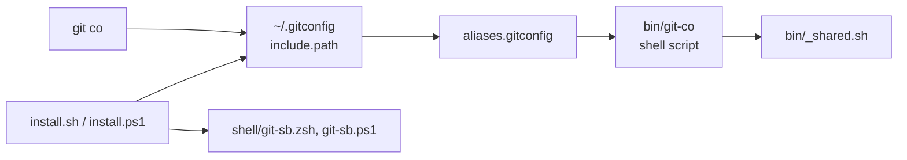

# Architecture

Each alias is a shell script in `bin/`. Git finds them through an include in `~/.gitconfig`.

| Part | Technology | Job |
| --- | --- | --- |
| Aliases | POSIX shell | The commands |
| Map | `aliases.gitconfig` | Alias name to script |
| Installer | Shell, PowerShell | Wires up `~/.gitconfig` |
| Checks | `lint.sh`, `test.sh`, pre-commit hook | Keep the scripts working |
