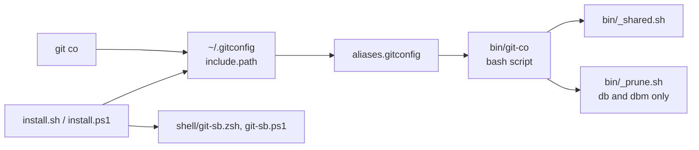
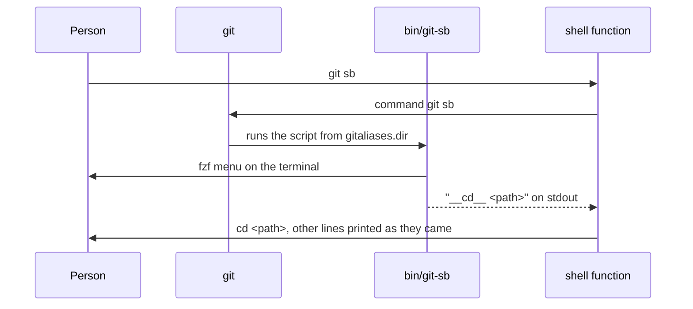

# Architecture

Each alias is a bash script in `bin/`. Git finds them through an include in
`~/.gitconfig`, and `gitaliases.dir` points at the clone.

| Part | Technology | Job |
| --- | --- | --- |
| Aliases | bash, `bin/git-*` | The commands |
| Helpers | `bin/_shared.sh`, `bin/_prune.sh` | Colours, questions, remote lookup, branch and worktree removal |
| Map | `aliases.gitconfig` | Alias name to script |
| Installers | `install.sh`, `install.ps1` | Wire up `~/.gitconfig`, the shell function and the hook |
| Shell functions | `shell/git-sb.zsh`, `shell/git-sb.ps1` | Turn the `__cd__ <path>` line of `git sb` into a `cd` |
| Checks | `lint.sh`, `test.sh`, `hooks/pre-commit`, `.github/workflows/lint.yml` | Keep the scripts working |
| Release | `.github/workflows/release.yml`, `.github/scripts/` | Tags each push to main that passes lint and publishes its notes |

## The path of one call

- **Data** the aliases keep no state of their own. They read and change the
  repo through git, and the installers change `~/.gitconfig`, `~/.zshrc` and
  `$PROFILE`.
- **Outside services** only the git remote, through `git fetch`, `git push`
  and `git pull`.
- **CI** `lint.yml` runs `lint.sh` and `test.sh` on each push and PR, on GitHub
  Linux and Windows runners.
- **Release** `release.yml` tags each push to main that passes `lint` and
  publishes its notes, on a GitHub Linux runner.
