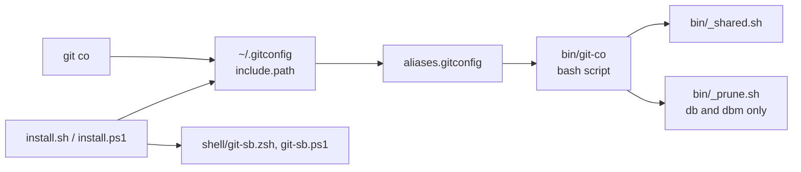
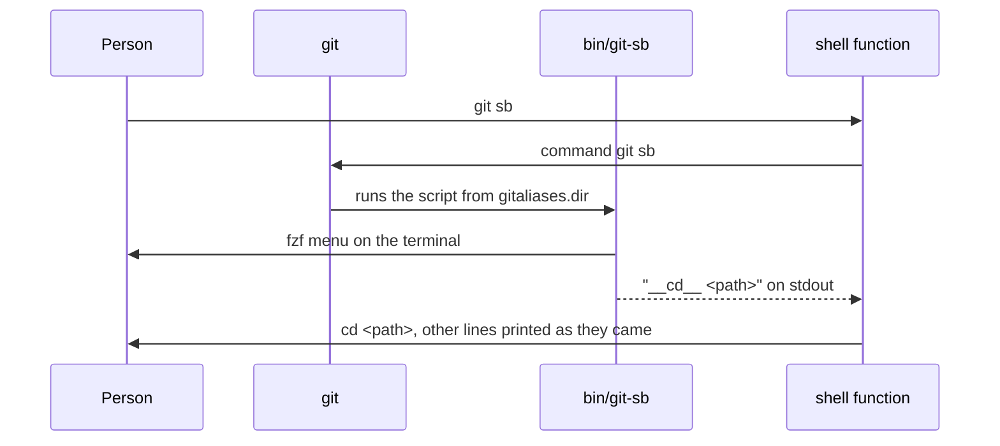

# Architecture

Each alias is a bash script in `bin/`. Git finds them through an include in
`~/.gitconfig`, and `gitaliases.dir` points at the clone.

| Part            | Technology                                                             | Job                                                             |
| --------------- | ---------------------------------------------------------------------- | --------------------------------------------------------------- |
| Aliases         | bash, `bin/git-*`                                                      | The commands                                                    |
| Helpers         | `bin/_shared.sh`, `bin/_prune.sh`                                      | Colours, questions, remote lookup, branch and worktree removal  |
| Map             | `aliases.gitconfig`                                                    | Alias name to script                                            |
| Installers      | `install.sh`, `install.ps1`                                            | Wire up `~/.gitconfig`, the shell function and the hook         |
| Shell functions | `shell/git-sb.zsh`, `shell/git-sb.ps1`                                 | Turn the `__cd__ <path>` line of `git sb` into a `cd`           |
| Checks          | `lint.sh`, `test.sh`, `hooks/pre-commit`, `.github/workflows/lint.yml` | Keep the scripts working                                        |
| Release         | `.github/workflows/release.yml`, `.github/scripts/`                    | Tags each push to main that passes lint and publishes its notes |

## The path of one call

- **Data** the aliases keep no state of their own. They read and change the
  repo through git, and the installers change `~/.gitconfig`, `~/.zshrc` and
  `$PROFILE`.
- **Outside services** only the git remote, through `git fetch`, `git push`
  and `git pull`.
- **CI** `lint.yml` runs `lint.sh` and `test.sh` on each push and PR, on GitHub
  Linux and Windows runners.
- **Release** `release.yml` tags each push to main that passes `lint` and
  publishes its notes, on a GitHub Linux runner.

## Decisions

### Alias shape: a script in `bin/` per alias

- **Picked** each alias in `aliases.gitconfig` runs a script
  `bin/git-<name>`. `lint.sh` holds every line to that shape.
- **Why** a script takes many lines, `-h` help and shared helpers.
  shellcheck and `test.sh` can check it. The first version moved the aliases
  into scripts for that.
- **Trade-off** each alias costs a file, a map line and a README row.
- **Rejected**
  - **Inline `!` aliases in `.gitconfig`** one line of shell each, with no
    lint and no tests.
  - **Shell functions** one copy for zsh and another for PowerShell.
- **Cost to undo** high. Every alias moves.

### Language: bash

- **Picked** each script is bash with `set -euo pipefail`.
- **Why** git ships bash on every system. Git for Windows runs each `bin/`
  script in its own bash, so one script serves macOS, Linux and Windows.
- **Trade-off** the org rule writes scripts in TypeScript run by Node, so
  this repo is off that rule. A Windows checkout with CRLF endings breaks
  bash, so `.gitattributes` keeps LF.
- **Rejected**
  - **TypeScript run by Node** each machine would need Node to run a git
    alias.
  - **Rust** a binary to build per system for a few lines of git calls.
- **Cost to undo** high. A rewrite of every script and of `test.sh`.

### Install: an include that points at the clone

- **Picked** the installers set `gitaliases.dir` and `include.path` in
  `~/.gitconfig`. The aliases run from the clone itself.
- **Why** a `git pull` in the clone updates every alias. The installer
  doesn't need a second run.
- **Trade-off** moving or deleting the clone breaks the aliases. An
  `[alias]` section in `~/.gitconfig` beats them, so the installer offers to
  remove it.
- **Rejected**
  - **Copy the aliases into `~/.gitconfig`** each update needs a new install,
    and the copies drift.
- **Cost to undo** medium. Both installers change.

### Folder change: `git sb` prints `__cd__` for a shell function

- **Picked** `git sb` prints `__cd__ <path>`. A zsh or PowerShell function
  runs the `cd` and moves the VS Code window.
- **Why** a git alias runs as a child process. It can't change the folder of
  the shell above it.
- **Trade-off** each shell needs its own function, and the installer edits
  `~/.zshrc` or `$PROFILE`. Without the function, `git sb` prints the path
  and stays put.
- **Rejected**
  - **Print the path only** the person then types the `cd` each time.
  - **Start a new shell in the folder** each switch would stack another
    shell.
- **Cost to undo** medium. `bin/git-sb` and both files in `shell/`.

### Installers: one per system

- **Picked** `install.sh` for macOS and Linux, `install.ps1` for Windows.
  Both ask before each change and copy each file they edit.
- **Why** `install.sh` hooks into zsh, so `git sb` couldn't change folder in
  PowerShell. Windows needs `$PROFILE`.
- **Trade-off** each step exists twice, and the two can drift.
- **Rejected**
  - **`install.sh` in Git Bash only** it reaches `~/.gitconfig` but not the
    PowerShell profile.
- **Cost to undo** medium. Both installers and the README install steps change.

### Checks: `lint.sh`, `test.sh` and a pre-commit hook

- **Picked** `lint.sh` runs shellcheck and shfmt and checks the repo rules:
  each alias has a script, a description and a README row. `test.sh` runs
  the aliases on scratch repos. `core.hooksPath` runs the lint on each
  commit.
- **Why** the rules drift without a check, and a hook catches it before the
  push.
- **Trade-off** `test.sh` expects Git for Windows paths, so on Linux it stops
  early.
- **Rejected**
  - **husky** the org's hook tool, but it needs Node and a `package.json`,
    and this repo has neither.
- **Cost to undo** low. Two scripts and a hook.

### CI: GitHub runners, Linux and Windows

- **Picked** `lint.yml` runs on `ubuntu-latest` and `windows-latest`, on
  pushes and PRs. `release.yml` tags each green push to `main`.
- **Why** the repo is public, so GitHub runners cost 0 minutes. Git Bash and
  Linux both run the aliases, so both get checked.
- **Trade-off** CI waits on GitHub's queue in place of the PC.
- **Rejected**
  - **The Windows PC runner** a public repo would run outside code from PRs
    on the PC.
- **Cost to undo** low. The `runs-on` lines.
