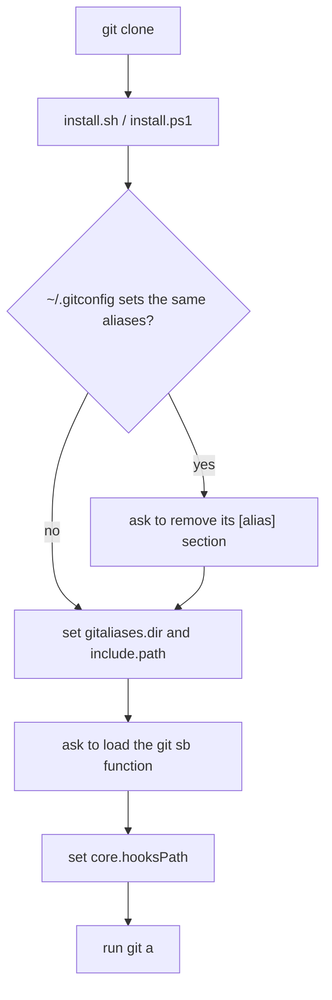
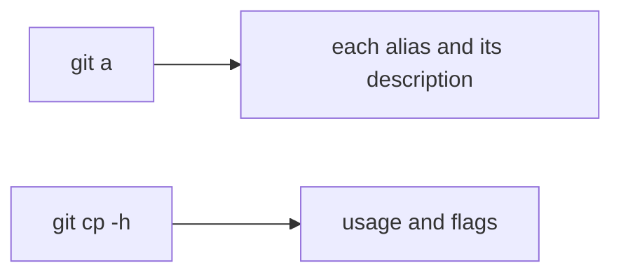
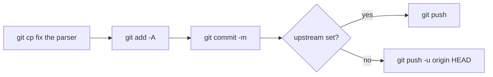
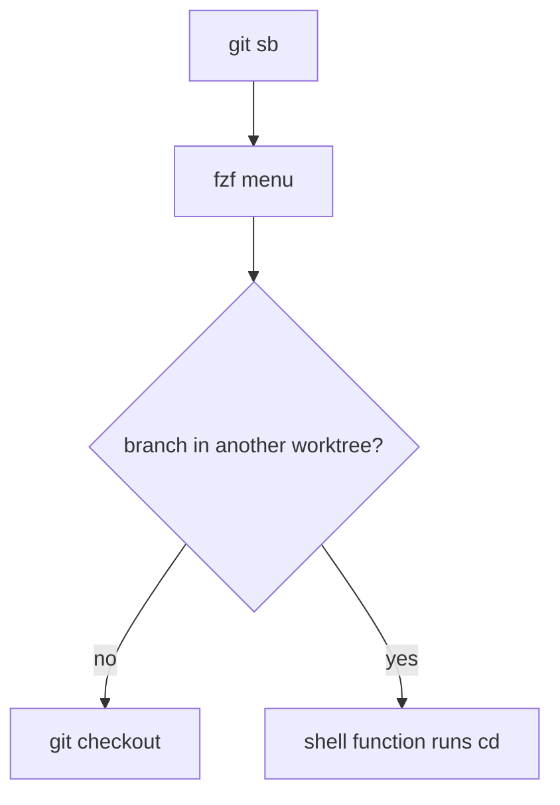
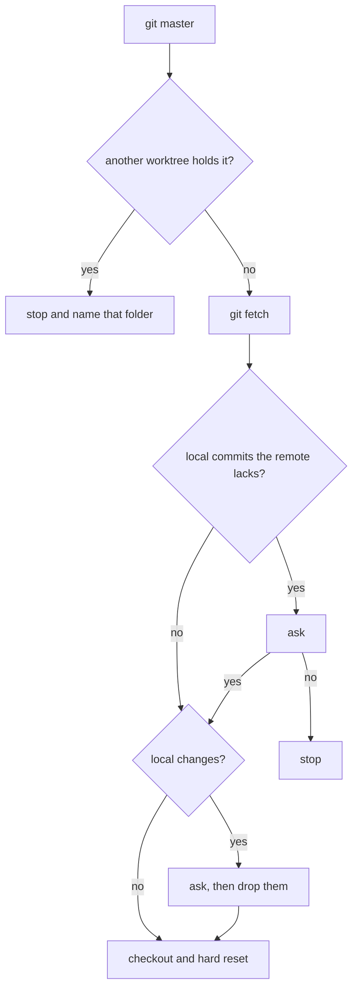
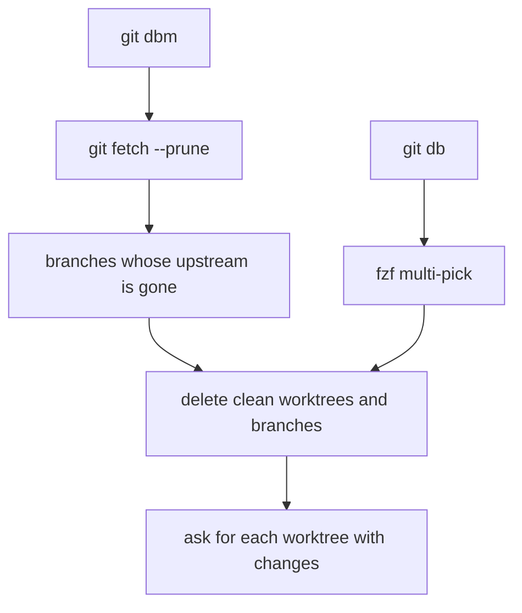

# User flows

## Install on a new machine

1. The person clones the repo.
2. The person runs `install.sh`, or `install.ps1` on Windows.
3. The installer asks before each change and copies each file it edits.
4. The installer runs `git a` to prove the aliases work.

## Look up an alias

1. The person runs `git a`.
2. The list opens in `less`, one alias per entry with its description.
3. An alias run with `-h`, or with its arguments missing, prints its usage.

## Commit and push

1. The person runs `git cp <message>`.
2. The alias stages all, commits, and pushes.
3. A branch with no upstream gets one on this push.

## Switch to a branch in another worktree

1. The person runs `git sb`.
2. fzf lists the local branches, newest first, with the folder of each worktree.
3. The person picks one.
4. A branch in this worktree gets checked out. A branch in another worktree
   moves the shell there.

## Go back to the default branch

1. The person runs `git master`.
2. The alias stops when another worktree holds the default branch.
3. It lists commits the remote lacks and local changes, with a question each.
4. It checks out the default branch and resets it to the remote.

## Clean up branches and worktrees

1. The person runs `git dbm` after a PR merges, or `git db` to pick by hand.
2. The alias deletes clean worktrees and plain branches first.
3. Each worktree with changes gets a question at the end.

